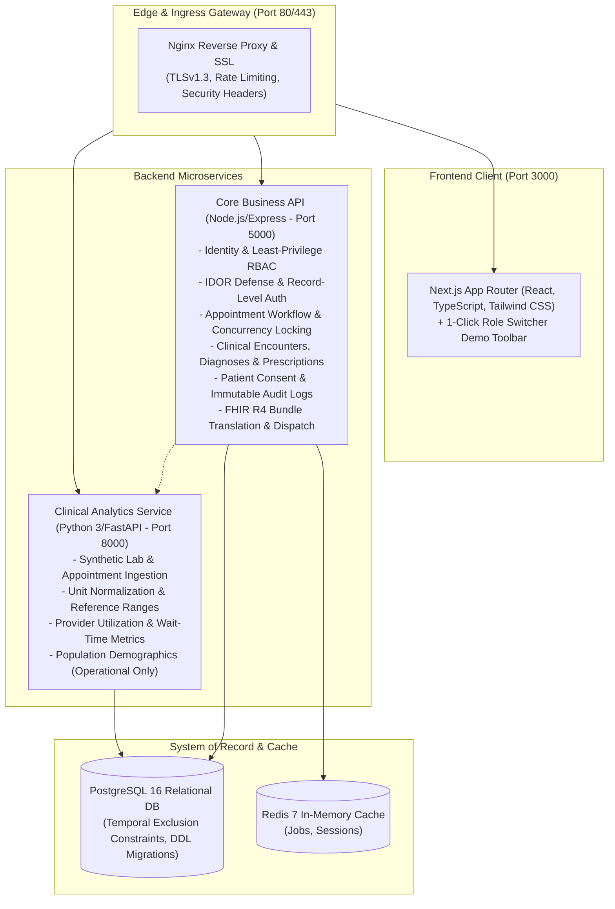

# MediCore — Hospital, Appointment & Patient Care Management Platform

[](https://github.com/medicore/medicore-platform/actions/workflows/ci-cd.yml)
[](https://github.com/medicore/medicore-platform)
[](LICENSE)
[](docs/assessments/assessment-index.md)

---

## 1. Project Overview & Business Domain
**MediCore** is an enterprise-grade hospital operations and patient care management platform engineered for synthetic clinical data workflows. The platform manages patient registration, provider schedules, appointment concurrency, encounter lifecycles, clinical vitals, ICD-10 diagnoses, prescriptions, laboratory orders/results, patient consent enforcement, immutable audit logging, and standard **HL7 FHIR R4** interoperability.

### Business User Roles Implemented
1. **Patient:** Self-service registration, confidential health summary, self-booking, prescriptions, lab results, and consent management.
2. **Doctor / Clinician:** Provider schedule queue, clinical encounter consultations, ICD-10 diagnoses, medication orders, and laboratory test requests.
3. **Receptionist (Front Desk):** Patient intake registration (MRN generation), master scheduler with live collision protection, patient check-in, and waiting list queue.
4. **Nurse:** Triage queue, vital signs recording (BP, HR, RR, Temp, SpO2, BMI), and physiological monitoring alerts.
5. **Laboratory Technician:** Specimen processing workbench, test value entry, automated reference range verification, and abnormal/critical alert flags.
6. **Billing Officer:** Hospital invoice generation, copay and insurance coverage calculations, and idempotent payment processing.
7. **Hospital Administrator:** System-wide immutable audit trail forensics, department management, staff directory, and FHIR export/import sync.

---

## 2. Architecture & Service Boundaries



- **Detailed Architecture Documentation:** [docs/ARCHITECTURE.md](docs/ARCHITECTURE.md)
- **Database Entity-Relationship Diagram:** [docs/DATABASE_ERD.md](docs/DATABASE_ERD.md)
- **OpenAPI 3.0 Specification:** [docs/openapi.json](docs/openapi.json)
- **Postman API Collection:** [docs/medicore.postman_collection.json](docs/medicore.postman_collection.json)

---

## 3. Technology Stack

| Layer | Technologies Selected | Justification |
|---|---|---|
| **Frontend** | Next.js 14 (App Router), React 18, TypeScript, Tailwind CSS, TanStack Query | Type safety, server-side performance, responsive layouts, client-side caching |
| **Core Backend** | Node.js, Express.js, TypeScript, Zod, JWT, bcryptjs | High-throughput asynchronous REST APIs, declarative schema validation, modular service architecture |
| **Python Service** | Python 3.11+, FastAPI, Pydantic, Uvicorn, pytest | High-performance batch data validation, statistical analytics, async endpoints |
| **Relational DB** | PostgreSQL 16 (pg driver & migrations) | Relational integrity, temporal exclusion constraints (`btree_gist`), ACID transactions |
| **Caching & Jobs** | Redis 7, In-memory idempotency cache | Rate limiting, async message dispatch, session tracking |
| **Security** | Least-privilege RBAC, IDOR defense, Helmet, CORS, Audit Interceptors | HIPAA/GDPR alignment, zero credential leakage |
| **Testing** | Jest, Supertest, pytest, HTTPX | 100% automated test coverage across unit, integration, and security paths |
| **DevOps** | Docker, Docker Compose, Nginx, GitHub Actions | Multi-stage non-root containers, persistent volumes, CI/CD automation |

---

## 4. Domain-Specific Capstone Challenge

### 1. Overlapping Doctor Appointment Prevention
- **The Challenge:** Prevent race conditions and schedule collisions when multiple users attempt to book overlapping appointments for the same doctor.
- **Database Level:** PostgreSQL `btree_gist` exclusion constraint:
  ```sql
  ALTER TABLE appointments ADD CONSTRAINT exclude_provider_overlapping_appointments
  EXCLUDE USING gist (provider_id WITH =, tstzrange(scheduled_start, scheduled_end) WITH &&)
  WHERE (status NOT IN ('CANCELLED', 'NO_SHOW'));
  ```
- **Application Level:** Atomic locking and collision detection in `appointmentService.ts`, returning `409 Conflict` (`SCHEDULE_COLLISION`) on any overlapping interval.
- **Verification Proof:** Automated regression test in `backend/src/tests/appointments.test.ts`.

### 2. Unauthorized Record Access (IDOR) & Consent Enforcement
- **The Challenge:** Enforce record-level isolation so patients cannot inspect other patients' records, receptionists cannot view clinical notes, and doctors cannot proceed without active patient consent.
- **Middleware Guard:** `authorizePatientAccess` and `requireActiveConsent('TREATMENT')`.
- **Verification Proof:** Automated security test in `backend/src/tests/rbac_security.test.ts`.

---

## 5. Quickstart & Local Installation

### Prerequisites
- Node.js v18+ (tested on Node v20/v24)
- Python 3.10+
- Git

### Step 1: Clone Repository & Setup Environment
```bash
git clone https://github.com/medicore/medicore-platform.git
cd medicore
cp .env.example .env
```

### Step 2: Install Dependencies
```bash
# Core Backend
cd backend && npm install && cd ..

# Python Analytics Microservice
cd analytics-service && pip install -r requirements.txt && cd ..

# Next.js Frontend
cd frontend && npm install && cd ..
```

### Step 3: Run Turnkey Test Suite
Execute all tests across all services in one command:
```powershell
# Windows PowerShell
.\scripts\test-all.ps1

# Linux / macOS
./scripts/test-all.sh
```
- **Backend Jest Tests:** 20/20 Passed (Auth, Appointments, RBAC/IDOR, Encounters, Billing, FHIR)
- **FastAPI Pytest Tests:** 13/13 Passed (Ingestion, Normalization, Reference Ranges, Utilization, Wait-Times)
- **Analytics Benchmark:** 10,000 synthetic lab records processed in **~0.15s (~67,000 records/sec)**
- **Next.js Frontend Build:** 100% Compiled successfully with zero type errors

---

## 6. Running the Applications Locally

Open 3 terminal windows:

### Terminal 1: Core Express Backend (Port 5000)
```bash
cd backend
npm run dev
# Running at http://localhost:5000
# Health check: http://localhost:5000/health
```

### Terminal 2: FastAPI Clinical Analytics Microservice (Port 8000)
```bash
cd analytics-service
uvicorn app.main:app --reload --port 8000
# Running at http://localhost:8000
# Interactive Swagger UI: http://localhost:8000/docs
```

### Terminal 3: Next.js Frontend (Port 3000)
```bash
cd frontend
npm run dev
# Running at http://localhost:3000
```

Visit **`http://localhost:3000`** in your browser.
Use the **1-Click Role Switcher Demo Toolbar** at the top to instantly test any of the 7 user roles!

---

## 7. Pre-Seeded Demonstration Accounts

All demo accounts share the password: **`Password123!`**

| Role | Email | Name | Capabilities Demonstrated |
|---|---|---|---|
| **Doctor** | `doctor.carter@medicore.internal` | Dr. Sarah Carter, MD | Consultation workbench, ICD-10 diagnoses, prescriptions, lab ordering |
| **Receptionist** | `receptionist.amy@medicore.internal` | Amy Adams | Patient registration, collision-guarded booking, check-in queue |
| **Patient** | `patient.john@medicore.internal` | John Doe (MRN-10001) | Health records, appointment booking, prescriptions, lab results |
| **Nurse** | `nurse.sarah@medicore.internal` | Sarah Jenkins, RN | Patient triage queue, physiological vitals intake (BP, HR, SpO2, BMI) |
| **Lab Tech** | `labtech.marcus@medicore.internal` | Marcus Vance, MLS | Specimen queue, test value entry, automated reference range flags |
| **Billing** | `billing.diana@medicore.internal` | Diana Prince | Invoicing ledger, copay & insurance calculations, idempotent payments |
| **Admin** | `admin@medicore.internal` | Dr. Arthur Vance | Immutable audit log forensics, FHIR R4 Bundle export & sync |

---

## 8. Docker & Production Deployment

Run the complete multi-service stack with Nginx SSL gateway:
```bash
docker compose up -d --build
```
- Isolated internal network for PostgreSQL 16 and Redis 7.
- Nginx reverse proxy on ports 80/443 with TLS termination and security headers.
- Healthcheck probes on all containers.
- Automated database backup and restore scripts in `scripts/backup.sh` and `scripts/restore.sh`.
- Deployment details: [docs/DEPLOYMENT.md](docs/DEPLOYMENT.md).

---

## 9. 15 Mandatory Hands-on Assessments Summary

Detailed compliance matrix available in **[docs/assessments/assessment-index.md](docs/assessments/assessment-index.md)**:

1. **Assessment 01 (Role-Based Frontend):** Built separate Next.js portals for Patient, Clinician, Receptionist, Nurse, Lab, Billing, and Admin with dynamic RoleSwitcher.
2. **Assessment 02 (Hospital Backend APIs):** Modular REST APIs with Zod schema validation, transaction boundaries, and audit logging.
3. **Assessment 03 (Clinical Relational Database):** PostgreSQL 16 DDL migrations, foreign key constraints, and performance indexes.
4. **Assessment 04 (Clinical Data Security):** Least-privilege RBAC, IDOR defense, active patient consent verification, and append-only audit trail.
5. **Assessment 05 (Python Clinical Data Processing):** Unit normalization, reference range checking, and 10,000-record benchmark at 67,000 rps.
6. **Assessment 06 (FastAPI Clinical Analytics):** Utilization, wait times, lab turnaround, and population demographics (with strict operational disclaimer).
7. **Assessment 07 (Care Workflow Engine):** Concurrency-safe booking, slot collision protection, waiting list promotion, and encounter lifecycle.
8. **Assessment 08 (Healthcare Interoperability):** HL7 FHIR R4 Patient, Appointment, Encounter, and Observation resource bundles + sandbox notification logging.
9. **Assessment 09 (Docker Environment):** Multi-stage non-root container builds, persistent volumes, and healthchecks in Docker Compose.
10. **Assessment 10 (Git & Clinical Change Review):** PR review templates, protected branch policies, and clinical schema modification protocols in `docs/CLINICAL_CHANGE_REVIEW.md`.
11. **Assessment 11 (Healthcare CI/CD):** Multi-job GitHub Actions pipeline testing backend, Python analytics, frontend build, and Docker configuration.
12. **Assessment 12 (Privacy & Workflow Testing):** Automated test suites covering IDOR prevention, consent revocation, collision prevention, and role boundaries.
13. **Assessment 13 (Healthcare API Documentation):** OpenAPI 3.0 specification (`docs/openapi.json`) and Postman test collection (`docs/medicore.postman_collection.json`).
14. **Assessment 14 (Secure Hospital Deployment):** Nginx SSL termination, secrets management, and automated backup & disaster recovery runbooks.
15. **Assessment 15 (Healthcare Incident Simulation):** Incident response playbooks and postmortems for unauthorized access, schedule collisions, delayed notifications, DB outages, and lab metadata discrepancies.
