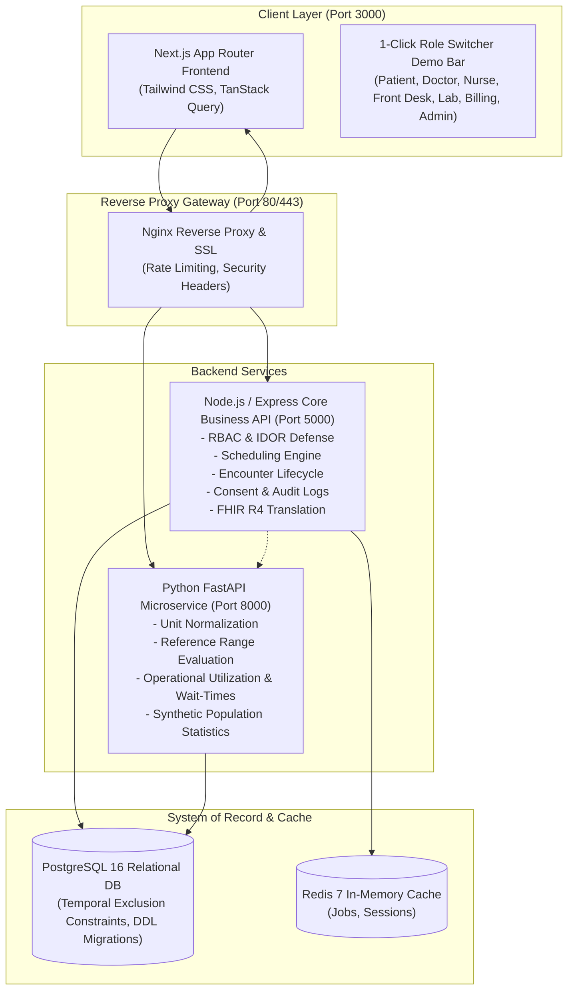

# MediCore Architecture & Engineering Specification

## 1. System Overview
MediCore is a modular, role-based hospital operations platform designed for synthetic patient care workflows. The platform enforces clinical data security, least-privilege authorization, active patient consent verification, appointment concurrency scheduling, and FHIR R4 interoperability.



## 2. Service Boundaries & Data Ownership

| Service | Responsibility | Authoritative Entities Owned |
|---|---|---|
| **Core Express API** | Primary clinical business rules, identity, security, transactions | `users`, `departments`, `providers`, `patients`, `appointments`, `encounters`, `vitals`, `diagnoses`, `prescriptions`, `lab_orders`, `lab_results`, `invoices`, `consents`, `audit_logs` |
| **FastAPI Analytics** | Operational metrics computation, batch data ingestion & validation | Ingests raw lab/appointment batches, computes utilization rates, wait times, lab turnaround, cohort statistics. *(Explicitly does not output clinical diagnoses)* |
| **Next.js Frontend** | Responsive user interface, role-specific views | Client-side role experiences, form validation, TanStack Query caching |

## 3. Concurrency Control: Preventing Overlapping Doctor Appointments
- **Capstone Challenge:** Prevent doctor scheduling collisions across concurrent bookings.
- **Database Level:** PostgreSQL `btree_gist` temporal exclusion constraint:
  ```sql
  ALTER TABLE appointments ADD CONSTRAINT exclude_provider_overlapping_appointments
  EXCLUDE USING gist (provider_id WITH =, tstzrange(scheduled_start, scheduled_end) WITH &&)
  WHERE (status NOT IN ('CANCELLED', 'NO_SHOW'));
  ```
- **Application Level:** Atomic lock in `appointmentService.ts`: checks slot collisions and returns `409 Conflict` with `SCHEDULE_COLLISION` before state mutation.

## 4. Privacy, Record-Level Authorization & IDOR Defense
- **Patient Isolation:** `authorizePatientAccess` middleware verifies `req.user.patientId === requestedId`. Cross-patient requests are blocked with `403 Forbidden` (`ACCESS_DENIED_IDOR`) and recorded as security alerts.
- **Receptionist Boundaries:** Receptionists are blocked from reading medical encounter notes, diagnoses, or lab results.
- **Consent Checks:** `requireActiveConsent('TREATMENT')` verifies active patient consent prior to initiating clinical encounters, prescribing medication, or ordering tests.
